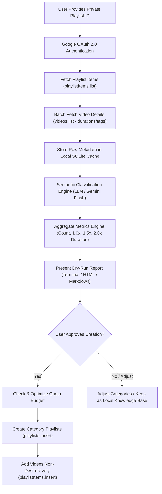

# PRD: Phase 0 — YouTube Private Playlist Ingestion, Categorization & Time-to-Complete Engine
**Status**: Draft for Alignment  
**Author**: Alex (Lead Product Manager)  
**Last Updated**: October 17, 2026  
**Version**: 0.1.0  
**Project**: YT KB (YouTube Knowledge Base)  

---

## 1. Executive Summary & Problem Deconstruction

### 1.1 The Problem
Users accumulate hundreds or thousands of high-value educational videos into private YouTube playlists (or "Watch Later"). Over time, this becomes a digital dumping ground—an unstructured, overwhelming backlog where knowledge is lost. 

YouTube's native platform offers **zero automated semantic clustering**, no **time-budgeting analytics** (e.g., *"How many hours will this topic take at 2x speed?"*), and clumsy manual playlist management. Users abandon their study queues because they cannot estimate the commitment required or separate actionable tutorials from general interest.

### 1.2 The "3 Whys" Root Cause Analysis
1. **Why do users need automated classification?**  
   *Because manual categorization of 200+ videos takes hours of tedious clicking, leading to cognitive fatigue and abandoned playlists.*
2. **Why must it be non-destructive (do not delete source)?**  
   *Because users view their primary playlist as a master archive / single source of truth; any destructive sync risks accidental content loss or breaking their historical queue.*
3. **Why do we need 2x duration and video counts upfront?**  
   *Because modern technical learners optimize for time-budgeted sprints. Knowing a category requires "14 videos / 3h 12m at 2x" transforms an intimidating backlog into a tangible, achievable learning session.*

### 1.3 Core Objectives
- Authenticate securely and ingest metadata from a user's private YouTube playlist.
- Semantically classify videos into coherent thematic topics without altering the original playlist.
- Calculate total video counts, standard duration (1.0x), and time-compressed watch durations (1.25x, 1.5x, 1.75x, 2.0x).
- Safeguard YouTube Data API quotas while enabling automated creation of categorized playlists.

---

## 2. Goals & Success Metrics

| Goal | Success Metric | Baseline | Target (Phase 0) | Measurement Method |
| :--- | :--- | :--- | :--- | :--- |
| **Ingestion Completeness** | % of accessible videos parsed | 0% | 100% of non-deleted items | Audit log comparison |
| **Classification Accuracy** | % of videos placed in relevant categories | 0% | ≥ 88% user acceptance | Dry-run review prompt |
| **Zero Data Loss** | Deleted items from source playlist | 0 | **Strictly 0** (Non-destructive) | Source playlist item check |
| **Quota Efficiency** | YouTube Data API quota cost | Unbounded | < 1,500 units for 300-video scan | Daily quota audit |
| **Time-to-Budget Precision** | Accurate calculation of 1x vs 2x duration | None | 100% mathematical precision | Video duration sum check |

---

## 3. Non-Goals (Explicit Boundaries for Phase 0)

To keep Phase 0 focused, lightweight, and fast to deliver, the following capabilities are **explicitly out of scope**:
- **Full Video Downloading / Transcribing**: We do not download mp4/mp3 or run Whisper on full audio in Phase 0 (metadata & official captions only).
- **Destructive Deletion / Auto-Archiving**: The source playlist will NEVER have items removed by default.
- **Bi-directional Live Sync**: We are not building a continuous real-time daemon in Phase 0; it runs as an on-demand batch ingestion/classification pipeline.
- **Full Custom Video Player**: We will not build a full-featured custom video player; watch progress will initially be tracked via state toggles or embedded links.

---

## 4. User Personas & Scenarios

### Primary Persona
- **Dev / Lifelong Learner ("Karan")**: Saves technical talks, deep-dive system design videos, AI paper walkthroughs, and tutorials. Has 250+ videos in a private playlist, habitually watches at 1.5x–2.0x speed, but feels overwhelmed by the unorganized mess.

### User Stories & Acceptance Criteria

#### Story 1: Secure Private Playlist Ingestion
*As a user, I want to authenticate my YouTube account securely so the system can read my private playlist metadata without exposing my credentials.*
- **AC 1.1**: User initiates OAuth 2.0 flow with explicit scopes (`https://www.googleapis.com/auth/youtube.readonly` for read-only preview; `https://www.googleapis.com/auth/youtube` when creating target playlists).
- **AC 1.2**: Tokens stored encrypted locally; refreshes automatically without re-prompting.
- **AC 1.3**: Handles pagination gracefully for playlists with >50 items up to 1,000+ items.
- **AC 1.4**: Gracefully ignores or flags deleted / private-unavailable videos without failing the batch.

#### Story 2: AI-Powered Semantic Categorization
*As a user, I want my videos classified into sensible, customizable categories so that related topics are grouped together.*
- **AC 2.1**: System extracts title, description snippet, tags, channel name, and duration.
- **AC 2.2**: Generates a normalized taxonomy (e.g., "AI & LLMs", "Frontend / UI", "System Architecture", "DevOps & Cloud", "Career & Productivity").
- **AC 2.3**: Allows user to define custom target categories or accept system-suggested dynamic clusters.
- **AC 2.4**: Allows multi-category tagging with a designated primary playlist assignment.

#### Story 3: Non-Destructive Playlist Generation
*As a user, I want the system to generate new YouTube playlists for each category while leaving my source playlist untouched.*
- **AC 3.1**: Target playlists are created under the user's account with title convention (e.g., `[YT-KB] AI & LLMs`).
- **AC 3.2**: Videos are added to the corresponding category playlist via API or queued batch.
- **AC 3.3**: Source playlist contents remain 100% intact.

#### Story 4: Duration & Speed Compression Engine
*As a user, I want to see the total video count and watch time at standard (1x) and accelerated speeds (1.25x, 1.5x, 1.75x, 2.0x) for each category.*
- **AC 4.1**: Parses ISO 8601 duration format (e.g., `PT1H23M45S`) into exact seconds.
- **AC 4.2**: Computes and formats aggregate durations into human-readable format: `X hrs Y mins`.
- **AC 4.3**: Displays compressed watch times:
  $$\text{Watch Time}_{2.0x} = \frac{\text{Total Duration (seconds)}}{2.0}$$
- **AC 4.4**: Displays completion tracking: marked as "Unwatched", "In Progress", or "Completed" with updated remaining time.

---

## 5. Architectural Options & Trade-Off Matrix (Rule of 3)

| Dimension | Option A: CLI + Local SQLite (Lean MVP) | Option B: Full-Stack Web App (FastAPI + React) | Option C: Local TUI / Desktop Tool (Rich CLI/Electron) |
| :--- | :--- | :--- | :--- |
| **Description** | Python script/CLI with OAuth, local SQLite cache, and interactive terminal review | Web dashboard with visual card board, OAuth login, and embedded player | Desktop GUI or rich interactive TUI (Textual) |
| **Time to Deliver** | **1–2 Weeks** (Fastest signal) | 4–5 Weeks | 3–4 Weeks |
| **YouTube Quota Risk** | **Low** (Dry-run by default; preview in terminal/markdown before API write) | Medium (Web triggers might spam API) | Low/Med |
| **User Experience** | Technical / Developer-friendly | Non-technical friendly | Rich terminal aesthetic |
| **API Portability** | Runs locally on user's machine; zero server hosting cost | Requires hosted server & redirect URI management | Runs locally |
| **Recommendation** | **Phase 0 Recommended** | Promote in Phase 1 / 2 | Alternative for Phase 1 |

### Architectural Decision
**Option A (Enhanced CLI with Local DB & HTML/Markdown Report)** is the recommended path for Phase 0:
1. It validates the classification pipeline and quota management in days without web infrastructure overhead.
2. It executes locally on `d:\YT KB`, keeping user OAuth tokens and private playlist data strictly on their machine.
3. It generates an immediate, interactive HTML/Markdown report that displays video counts and 1x/2x completion metrics, with a single confirmation command to sync to YouTube.

---

## 6. Technical Flow & System Architecture



---

## 7. Deep-Dive: YouTube API Quota Pre-Mortem & Safeguards

> [!WARNING]
> **The 10,000 Units/Day Quota Trap**:
> - `playlistItems.list`: **1 unit** per 50 videos (300 videos = 6 units).
> - `videos.list` (durations): **1 unit** per 50 videos (300 videos = 6 units).
> - `playlists.insert`: **50 units** per new playlist (5 categories = 250 units).
> - `playlistItems.insert`: **50 units per video**! For 300 videos, writing directly to YouTube costs:
>   $$300 \times 50 = 15,000 \text{ units!}$$
> This **exceeds** the default 10,000 daily quota limit in a single execution.

### Phase 0 Mitigation Strategy:
1. **Dry-Run & Virtual Organization First**: The system categorizes and calculates all metrics locally first (cost: ~15 units total).
2. **Batch Queue & User Selection**: Allow the user to select which categories to push to YouTube immediately vs keeping locally.
3. **Paced Daily Sync**: If total items exceed daily quota, provide automatic multi-day chunking or export as M3U/CSV/JSON alternatives.

---

## 8. Data Schema (Local SQLite Cache)

```sql
-- Playlists Table
CREATE TABLE playlists (
    id TEXT PRIMARY KEY,
    title TEXT NOT NULL,
    playlist_type TEXT CHECK(playlist_type IN ('source', 'generated')),
    total_videos INTEGER DEFAULT 0,
    total_duration_seconds INTEGER DEFAULT 0,
    created_at TIMESTAMP DEFAULT CURRENT_TIMESTAMP
);

-- Videos Table
CREATE TABLE videos (
    video_id TEXT PRIMARY KEY,
    title TEXT NOT NULL,
    channel_title TEXT,
    duration_iso TEXT,
    duration_seconds INTEGER NOT NULL,
    published_at TEXT,
    description_snippet TEXT,
    thumbnail_url TEXT
);

-- Video Category Mapping
CREATE TABLE video_categories (
    video_id TEXT,
    category_name TEXT,
    confidence_score REAL,
    is_primary BOOLEAN DEFAULT 1,
    status TEXT CHECK(status IN ('unwatched', 'in_progress', 'completed')) DEFAULT 'unwatched',
    FOREIGN KEY(video_id) REFERENCES videos(video_id),
    PRIMARY KEY(video_id, category_name)
);
```

---

## 9. Launch & Validation Plan

| Stage | Target Date | Milestone | Success Gate |
| :--- | :--- | :--- | :--- |
| **0.1 Spike** | Day 1–2 | OAuth 2.0 Auth + Read 100 items from private playlist | Read works; durations parsed |
| **0.2 Classification** | Day 3–4 | Metadata categorization + 2x watch metrics generated | Categories logical; duration math 100% exact |
| **0.3 Dry-Run Report**| Day 5 | Beautiful local HTML/Markdown report | User reviews counts and time estimates |
| **0.4 Non-Destructive Write** | Day 6–7 | Quota-aware playlist creation on YouTube | Source intact; new playlists populated safely |

---

## 10. Key Decisions & Open Alignment Questions

### Questions for You:
1. **Source Playlist Access**: Do you prefer setting up a standard Google Cloud OAuth Desktop Client (`credentials.json`), or would you prefer a web-based consent flow?
2. **Category Strategy**: Would you prefer:
   - **Predefined Taxonomies**: You specify 5–10 categories upfront (e.g., Coding, AI, Finance, Fitness).
   - **Autonomous Clustering**: The AI analyzes the titles and proposes natural clusters automatically.
   - **Hybrid**: AI proposes clusters, and you review/modify them in a quick CLI prompt before syncing.
3. **Execution Mode**: Do you want Phase 0 as a clean Python CLI tool in this folder (`d:\YT KB`) that outputs a visual dashboard report and handles the sync?
